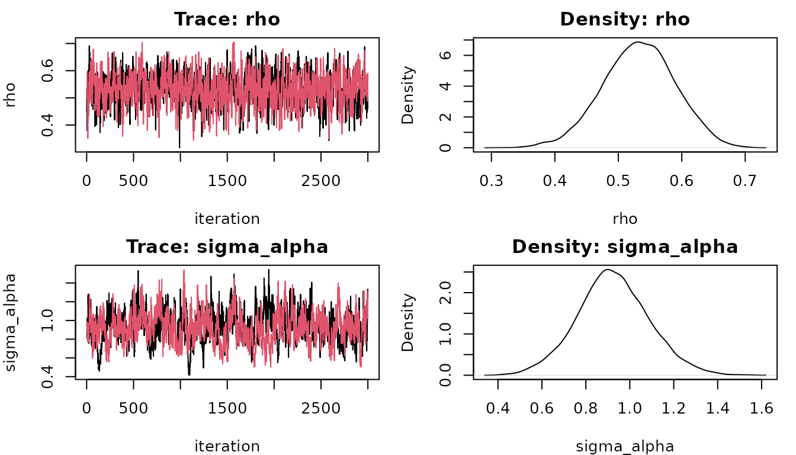

# Getting started with panel spatial probit

`panelspatialprobit` fits Bayesian spatial probit models to panel data:
the same $`N`$ spatial units (regions, firms, households) observed over
$`T`$ periods, with a binary outcome that may depend on the outcomes of
neighbouring units. This vignette walks through a complete analysis.
Ordered outcomes are covered in
[`vignette("ordered-outcomes")`](https://gueyenono.github.io/panelspatialprobit/articles/ordered-outcomes.md),
impacts in more depth in
[`vignette("impacts")`](https://gueyenono.github.io/panelspatialprobit/articles/impacts.md),
dynamic models in
[`vignette("dynamics")`](https://gueyenono.github.io/panelspatialprobit/articles/dynamics.md),
and the evidence that the samplers are correct in
[`vignette("validation")`](https://gueyenono.github.io/panelspatialprobit/articles/validation.md).

``` r

library(panelspatialprobit)
```

## The model

For period $`t`$, the $`N`$ latent outcomes follow

``` math
z_t = \rho W z_t + X_t\beta + W X_t\theta + \alpha + \varepsilon_t,
\qquad \varepsilon_t \sim N(0, I_N),
```

and we observe $`y_{it} = 1`$ when $`z_{it} > 0`$. The pieces are:

- $`W`$, an $`N \times N`$ spatial weights matrix (zero diagonal,
  usually row-standardised) that says who is a neighbour of whom;
- $`\rho`$, the spatial autoregressive parameter: the latent propensity
  of a unit depends on that of its neighbours;
- $`\theta`$, optional effects of the neighbours’ regressors ($`WX`$,
  “Durbin” terms);
- $`\alpha_i \sim N(0, \sigma_\alpha^2)`$, unit random effects that
  persist over time.

The `model` argument chooses the spatial terms. The error-term models
replace $`\varepsilon_t`$ by $`u_t = \lambda M u_t + \varepsilon_t`$,
where the error weights `M` default to `W`:

| `model`           | $`\rho`$ | $`\theta`$ | $`\lambda`$ |
|-------------------|----------|------------|-------------|
| `"sar"` (default) | yes      | no         | no          |
| `"sdm"`           | yes      | yes        | no          |
| `"slx"`           | no       | yes        | no          |
| `"sem"`           | no       | no         | yes         |
| `"sdem"`          | no       | yes        | yes         |
| `"sarar"`         | yes      | no         | yes         |
| `"none"`          | no       | no         | no          |

Spatially correlated errors do not create spillovers: in `"sem"` the
indirect impacts are zero, but the error term still changes the
probabilities through the variance of the latent outcome.

## Spatial weights and data layout

The data must be a **balanced panel in long format**: one row per unit
and period, with columns identifying both. The weights matrix carries
the unit identifiers as row names, and every unit in the data must match
a row of `W`. The order of the rows in `data` does not matter.

Here we use a 10 × 10 grid of units with rook contiguity and simulate
data from a known model:

``` r

W <- psp_weights(rook_weights(10, 10), style = "W")   # row-standardised
d <- sim_psprobit(W, T = 5, beta = c(-0.2, 1, -0.8), rho = 0.5,
                  sigma_alpha = 0.7, seed = 42)
head(d)
#>   id time y         x1           x2
#> 1  1    1 1  1.3709584  1.029140719
#> 2  2    1 0 -0.5646982  0.914774868
#> 3  3    1 1  0.3631284 -0.002456267
#> 4  4    1 1  0.6328626  0.136009552
#> 5  5    1 1  0.4042683 -0.720153545
#> 6  6    1 0 -0.1061245 -0.198124330
```

[`psp_weights()`](https://gueyenono.github.io/panelspatialprobit/reference/psp_weights.md)
also accepts dense matrices and `spdep` `nb` or `listw` objects. With
real data you would typically build `W` with `spdep`, for example
`psp_weights(spdep::nb2listw(spdep::poly2nb(polygons)), ids = polygons$region_id)`.

## Fitting

``` r

fit <- psprobit(y ~ x1 + x2, data = d, index = c("id", "time"), W = W,
                model = "sar", effects = "random",
                control = psp_control(iter = 3000, warmup = 1000, chains = 2,
                                      seed = 1, progress = FALSE))
fit
#> Bayesian panel spatial probit (model = sar, effects = random) 
#> Call: psprobit(formula = y ~ x1 + x2, data = d, index = c("id", "time"), 
#>     W = W, model = "sar", effects = "random", control = psp_control(iter = 3000, 
#>         warmup = 1000, chains = 2, seed = 1, progress = FALSE))
#> 
#> (Intercept)          x1          x2         rho sigma_alpha 
#>      -0.351       1.251      -0.915       0.533       0.925
```

[`psp_control()`](https://gueyenono.github.io/panelspatialprobit/reference/psp_control.md)
sets the chain lengths, the number of chains and cores, and a seed:
results are reproducible given the seed, whatever the number of cores.
The defaults are 4 chains of 2,000 draws after 1,000 warm-up iterations;
we use 2 longer chains here. Binary data carry little information per
observation, so the chains are autocorrelated and need more iterations
than a linear model would. Mixing is slowest with rare outcomes (roughly
under 10% ones), outcomes that barely vary within units, strong latent
dynamics and `"sarar"` with `M = W`. There, the intercept, $`\rho`$ and
$`\sigma_\alpha`$ trade off against each other and their chains move
slowly. The fix is more iterations: increase `iter` and `warmup` (and
`thin`, to save memory) until the convergence warning disappears. The
“Convergence” section of
[`?psprobit`](https://gueyenono.github.io/panelspatialprobit/reference/psprobit.md)
gives the details.

## Checking convergence

The summary reports $`\hat R`$ and the bulk and tail effective sample
sizes (ESS) for each parameter.
[`psprobit()`](https://gueyenono.github.io/panelspatialprobit/reference/psprobit.md)
warns when $`\hat R > 1.01`$ or the bulk ESS is below 100 per chain.

``` r

summary(fit)
#> Bayesian panel spatial probit (model = sar, effects = random) 
#> Call: psprobit(formula = y ~ x1 + x2, data = d, index = c("id", "time"), 
#>     W = W, model = "sar", effects = "random", control = psp_control(iter = 3000, 
#>         warmup = 1000, chains = 2, seed = 1, progress = FALSE))
#> Units: 100, periods: 5, observations: 500
#> Chains: 2, posterior draws: 6000
#> Outcome distribution:
#> 
#>   0   1 
#> 318 182 
#> 
#> Posterior summary:
#>               mean    sd   q2.5  q97.5  rhat ess_bulk ess_tail
#> (Intercept) -0.351 0.117 -0.584 -0.123 1.002      569     1115
#> x1           1.251 0.139  0.991  1.542 1.005      405      727
#> x2          -0.915 0.117 -1.146 -0.686 1.005      507     1268
#> rho          0.533 0.057  0.419  0.640 1.001      744     1422
#> sigma_alpha  0.925 0.163  0.606  1.261 1.003      230      441
#> 
#> In-sample classification: hit rate 0.756, AUC 0.843
#> 
#> Impacts on P(y = 1) (posterior mean, sd, 95% interval; 500 draws)
#> 
#> direct:
#>      mean    sd   q2.5  q97.5
#> x1  0.217 0.016  0.187  0.247
#> x2 -0.159 0.014 -0.186 -0.132
#> 
#> indirect:
#>      mean    sd   q2.5  q97.5
#> x1  0.209 0.041  0.136  0.296
#> x2 -0.153 0.032 -0.221 -0.097
#> 
#> total:
#>      mean    sd   q2.5  q97.5
#> x1  0.427 0.047  0.339  0.530
#> x2 -0.312 0.040 -0.404 -0.243
```

The truth here is $`\beta = (-0.2, 1, -0.8)`$, $`\rho = 0.5`$ and
$`\sigma_\alpha = 0.7`$. Trace and density plots come from `plot(fit)`,
and the draws are available as a `posterior` draws object
(`posterior::as_draws(fit)`) for use with packages such as `bayesplot`.

``` r

plot(fit, pars = c("rho", "sigma_alpha"))
```



## Interpreting the results: impacts

In a spatial model the coefficients are not marginal effects. A change
in $`x_{jt}`$ changes the latent outcome of unit $`j`$ and, through
$`(I - \rho W)^{-1}`$, those of its neighbours, their neighbours, and so
on; the probit link then translates those latent changes into
probability changes. The **impacts** summarise this (LeSage and Pace
2009):

- **direct:** the average effect of a unit’s own regressor on its own
  probability, including feedback through its neighbours;
- **indirect:** the average effect on the other units (the spillover);
- **total:** direct + indirect.

``` r

fit$impacts
#> Impacts on P(y = 1) (posterior mean, sd, 95% interval; 500 draws)
#> 
#> direct:
#>       mean     sd    q2.5   q97.5
#> x1  0.2174 0.0155  0.1873  0.2472
#> x2 -0.1590 0.0144 -0.1864 -0.1323
#> 
#> indirect:
#>       mean     sd    q2.5   q97.5
#> x1  0.2095 0.0413  0.1363  0.2961
#> x2 -0.1534 0.0319 -0.2214 -0.0969
#> 
#> total:
#>       mean     sd    q2.5   q97.5
#> x1  0.4269 0.0473  0.3386  0.5305
#> x2 -0.3124 0.0396 -0.4038 -0.2428
```

Impacts are computed by default after fitting.
[`psp_impacts()`](https://gueyenono.github.io/panelspatialprobit/reference/psp_impacts.md)
recomputes them with other options:

- `type = "unit"` conditions on the estimated random effects (impacts
  for the units in the sample) instead of averaging over them;
- `by_period = TRUE` also reports impacts within each period;
- `scale = "lesage_pace"` reproduces the scaling used by the
  `spatialprobit` package, for comparison with published results.

[`vignette("impacts")`](https://gueyenono.github.io/panelspatialprobit/articles/impacts.md)
explains the computation, which models have spillovers, and how to use
the draws.

``` r

imp_unit <- psp_impacts(fit, type = "unit", by_period = TRUE, draws = 200)
head(summary(imp_unit))
#>   variable category   effect period       mean         sd       q2.5      q97.5
#> 1       x1        1   direct    all  0.2208096 0.01492168  0.1892897  0.2486705
#> 2       x2        1   direct    all -0.1618325 0.01363099 -0.1866772 -0.1392160
#> 3       x1        1 indirect    all  0.2147444 0.04477170  0.1418654  0.3045209
#> 4       x2        1 indirect    all -0.1575337 0.03469548 -0.2410049 -0.1014747
#> 5       x1        1    total    all  0.4355539 0.05022449  0.3461200  0.5301409
#> 6       x2        1    total    all -0.3193662 0.04154884 -0.4108998 -0.2524161
```

## Predictions and fit

[`predict()`](https://rdrr.io/r/stats/predict.html) returns posterior
mean probabilities (or the latent index, or the most probable outcome)
in the row order of the data, and
[`psp_classification()`](https://gueyenono.github.io/panelspatialprobit/reference/psp_classification.md)
compares them with the observed outcomes:

``` r

head(predict(fit))
#> [1] 0.5199544 0.1756604 0.4109442 0.5170297 0.5506444 0.4468923
cl <- psp_classification(fit)
cl$hit_rate
#> [1] 0.756
cl$auc
#> [1] 0.8430437
cl$confusion
#>         predicted
#> observed   0   1
#>        0 271  47
#>        1  75 107
```

## Richer specifications

**Spatial Durbin.** `model = "sdm"` adds the spatial lags of the
regressors (columns named `W_x1`, …). The `durbin` argument restricts
them to some regressors. Impacts combine $`\beta`$ and $`\theta`$
automatically.

**Correlated random effects.** Random effects assume $`\alpha`$ is
independent of the regressors. When that is doubtful, the Mundlak device
adds each unit’s mean of the chosen regressors (`cre = ~ x1`, columns
`mean_x1`), and the Chamberlain device adds their values in every period
(`cre = list(type = "chamberlain", vars = ~ x1)`). This is the usual
alternative to fixed effects in nonlinear panel models, which suffer
from the incidental-parameters problem when $`T`$ is small.

**Time effects.** `time_effects = TRUE` adds period dummies.

``` r

fit_sdm <- psprobit(y ~ x1 + x2, data = d, index = c("id", "time"), W = W,
                    model = "sdm", cre = ~ x1, time_effects = TRUE, impacts = FALSE,
                    control = psp_control(iter = 3000, warmup = 1000, chains = 2,
                                          seed = 2, progress = FALSE))
round(coef(fit_sdm), 2)
#> (Intercept)          x1          x2        W_x1        W_x2     mean_x1 
#>       -0.27        1.33       -0.95       -0.08       -0.05        0.04 
#>      time_2      time_3      time_4      time_5         rho sigma_alpha 
#>        0.01       -0.30       -0.12       -0.14        0.53        1.02
```

**Dynamics.** `dynamic = psp_dynamic()` adds the previous period’s
outcome (`lag_y`, and with `lag_Wy = TRUE` its spatial lag `W_lag_y`).
The first period then serves only as the initial condition. By default
the random effects follow Wooldridge (2005): the first-period outcome
(`init_y`) and the unit means of the regressors are added to the model,
which deals with the correlation between the initial condition and the
random effects. The impacts of the regressors are then short-run
(within-period) impacts.

``` r

d_dyn <- sim_psprobit(W, T = 6, beta = c(-0.4, 1, -0.8), rho = 0.4,
                      sigma_alpha = 0.5, gamma = 0.8, seed = 3)
fit_dyn <- psprobit(y ~ x1 + x2, data = d_dyn, index = c("id", "time"), W = W,
                    dynamic = psp_dynamic(), impacts = FALSE,
                    control = psp_control(iter = 3000, warmup = 1000, chains = 2,
                                          seed = 3, progress = FALSE))
#> Warning: Possible convergence problems (R-hat > 1.01 or bulk ESS < 200) for:
#> sigma_alpha. Consider more iterations.
round(coef(fit_dyn), 2)
#> (Intercept)          x1          x2       lag_y      init_y     mean_x1 
#>       -0.64        1.05       -1.04        0.87        0.41        0.14 
#>     mean_x2         rho sigma_alpha 
#>        0.39        0.51        0.17
```

Because the outcome feeds back into later periods, a change in a
regressor keeps acting after it ends.
[`psp_response_path()`](https://gueyenono.github.io/panelspatialprobit/reference/psp_response_path.md)
traces this by simulating the outcome histories with and without the
change (using the same random numbers in both) and comparing the
probabilities period by period. Here $`x_1`$ rises by one unit in the
first modelled period only:

``` r

psp_response_path(fit_dyn, "x1", draws = 200, nsim = 10, seed = 1)
#> Response of P(y = 1) to a temporary shock of 1 in x1 (200 draws x 10 histories)
#> 
#> Average change over all units:
#>  horizon period   mean     sd   q2.5  q97.5
#>        0      2 0.3189 0.0286 0.2715 0.3762
#>        1      3 0.1152 0.0292 0.0626 0.1713
#>        2      4 0.0424 0.0191 0.0134 0.0867
#>        3      5 0.0135 0.0086 0.0021 0.0330
#>        4      6 0.0059 0.0051 0.0004 0.0173
```

The first row is the short-run impact. The later rows come only from the
lagged outcome, which decays at a rate set by `lag_y`.
`type = "permanent"` keeps the change in place, and `units =` shocks
only some units, in which case the spillovers to the others are reported
separately.
[`vignette("dynamics")`](https://gueyenono.github.io/panelspatialprobit/articles/dynamics.md)
covers the initial conditions problem, response paths and latent
dynamics in more detail.

**Latent dynamics.** `psp_dynamic(latent = TRUE)` puts the persistence
in the latent outcome instead,
$`z_t = \rho W z_t + \gamma z_{t-1} + X_t\beta +
\alpha + u_t`$ (Wang and Kockelman 2009), with $`\gamma`$ reported as
`lag_z`. All periods are modelled, and probabilities and impacts
integrate over the latent history.

**Robust errors.** `errors = psp_t(df = 7)` replaces the normal errors
by Student-t errors (the robit model), which limits the influence of
observations the model fits badly; `fit$v_mean` shows which ones they
are.

**Spatially autocorrelated random effects.**
`effects = "spatial_random"` lets the unit effects themselves be
spatially correlated, $`\alpha = \phi W\alpha + a`$ with
$`a_i \sim N(0, \sigma_\alpha^2)`$, so that neighbouring units share
unobserved characteristics (Wang and Kockelman 2009). The posterior of
$`\phi`$ is reported with the other parameters.

**Time-varying weights.** When the neighbourhood structure changes over
time (trade links, commuting flows, a network), pass `W` as a list with
one matrix per period, named by period. Every period then uses its own
matrix, in the spatial lag, the Durbin terms, the spatial lag of the
lagged outcome and the impacts:

``` r

W_list <- list(`2019` = W2019, `2020` = W2020, `2021` = W2021)
psprobit(y ~ x1 + x2, data, index = c("id", "year"), W = W_list)
```

## Checking the model

**Posterior predictive checks.**
[`psp_ppc()`](https://gueyenono.github.io/panelspatialprobit/reference/psp_ppc.md)
simulates replicated outcomes from the posterior and compares them with
the data on three statistics in each period: the share of each outcome,
Moran’s I (spatial dependence) and, with several periods, the share of
units whose outcome repeats from the previous period (persistence).
Posterior predictive p-values near 0 or 1 point to features of the data
the model does not reproduce.

``` r

psp_ppc(fit, draws = 200, seed = 1)
#> Posterior predictive checks (200 replicates)
#> ppp = P(T(y_rep) >= T(y)); values near 0 or 1 signal misfit.
#> 
#> share:
#>            observed rep_mean rep_q2.5 rep_q97.5   ppp
#> P(y=1) t=1     0.44    0.398     0.29      0.52 0.245
#> P(y=1) t=2     0.38    0.341     0.26      0.43 0.260
#> P(y=1) t=3     0.35    0.420     0.32      0.51 0.920
#> P(y=1) t=4     0.35    0.358     0.27      0.46 0.600
#> P(y=1) t=5     0.30    0.301     0.21      0.40 0.560
#> 
#> moran:
#>           observed rep_mean rep_q2.5 rep_q97.5   ppp
#> Moran t=1    0.266    0.207    0.048     0.390 0.240
#> Moran t=2    0.234    0.183    0.032     0.317 0.265
#> Moran t=3    0.141    0.205    0.067     0.358 0.840
#> Moran t=4    0.047    0.184    0.034     0.314 0.960
#> Moran t=5    0.130    0.059   -0.080     0.211 0.175
#> 
#> persistence:
#>             observed rep_mean rep_q2.5 rep_q97.5   ppp
#> persist t=2     0.56    0.585     0.49     0.670 0.695
#> persist t=3     0.61    0.606     0.52     0.701 0.510
#> persist t=4     0.56    0.578     0.48     0.660 0.730
#> persist t=5     0.67    0.636     0.55     0.730 0.285
```

**Model comparison.** The likelihood of a spatial probit is a
high-dimensional normal probability.
[`psp_loglik()`](https://gueyenono.github.io/panelspatialprobit/reference/psp_loglik.md)
estimates it by simulation (GHK), and
[`logLik()`](https://rdrr.io/r/stats/logLik.html),
[`AIC()`](https://rdrr.io/r/stats/AIC.html) and
[`psp_dic()`](https://gueyenono.github.io/panelspatialprobit/reference/psp_loglik.md)
build on it. This is experimental: the estimates carry Monte Carlo
error, reported in `attr(, "mcse")`. Pooled models and conditional
likelihoods are cheap to estimate precisely. The marginal likelihood of
a random-effects model is reliable only for small panels.

``` r

psp_dic(fit, draws = 100, reps = 500)
```

## Priors

The defaults are weakly informative: $`\beta \sim N(0, 10^2)`$,
$`(\rho + 1)/2 \sim \text{Beta}(1.01, 1.01)`$ (almost uniform on
$`(-1, 1)`$), $`\sigma_\alpha \sim \text{half-Cauchy}(0, 1)`$ and, for
ordered models, $`N(0, 10^2)`$ cut-points. Change them with
[`psp_priors()`](https://gueyenono.github.io/panelspatialprobit/reference/psp_priors.md):

``` r

psp_priors(beta = prior_normal(0, 2.5), rho = prior_beta(2, 2),
           sigma_alpha = prior_half_cauchy(0.5))
```

Binary data carry limited information about $`\rho`$, especially with
few periods, so it is worth checking how much the posterior of $`\rho`$
moves away from its prior.

## References

Albert, J. H. and Chib, S. (1993). Bayesian analysis of binary and
polychotomous response data. *Journal of the American Statistical
Association* 88, 669–679.

LeSage, J. P. and Pace, R. K. (2009). *Introduction to Spatial
Econometrics*. CRC Press.

Wang, X. and Kockelman, K. M. (2009). Bayesian inference for ordered
response data with a dynamic spatial-ordered probit model. *Journal of
Regional Science* 49, 877–913.

Wooldridge, J. M. (2005). Simple solutions to the initial conditions
problem in dynamic, nonlinear panel data models with unobserved
heterogeneity. *Journal of Applied Econometrics* 20, 39–54.

Wooldridge, J. M. (2010). *Econometric Analysis of Cross Section and
Panel Data*, 2nd ed. MIT Press.
